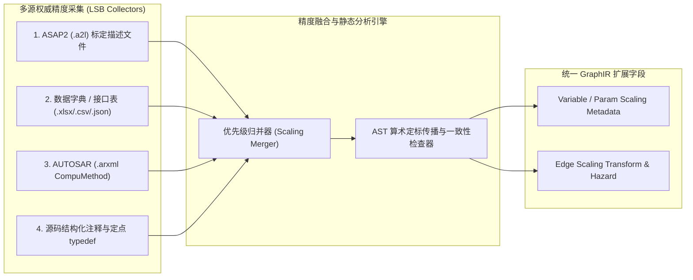

# TCU 定点数 LSB 精度解析、传播校验与可视化技术设计方案

> 状态：架构设计冻结（待后续排期实施）  
> 适用范围：`tcu-callgraph` 解析中间层（`GraphIR`）、工程差分引擎与画布信号层渲染

---

## 1. 背景与 TCU 领域痛点

在汽车自动变速箱控制单元（TCU：AT / DCT / CVT / DHT / 电驱减速器）嵌入式软件中，出于实时性、确定性、FPU 资源受限以及历史成熟算法库传承（尤其是日系电装/爱信/加特可体系与国内主流控制器定点标定体系），大量核心物理信号采用**定点整数（Fixed-Point Integer）**表示：

| 物理信号示例 | C 存储类型 | 典型 LSB（分辨率） | Offset（偏移） | 物理单位 | 工程常见表示法 |
| :--- | :--- | :--- | :--- | :--- | :--- |
| 输入轴/涡轮转速 `n_turb` | `uint16_t` | `0.25` (`2^-2`) | `0` | `rpm` | 二进制 Q2 定点 |
| 车速 `v_veh` | `uint16_t` | `1/256` (`0.00390625`, `2^-8`) | `0` | `km/h` | 二进制 Q8 定点 |
| 离合器目标油压 `p_clutch_req` | `int16_t` | `0.1` | `0` | `kPa` | 十进制标定因子 |
| 请求干预扭矩 `trq_req` | `int16_t` | `0.5` (`2^-1`) 或 `0.1` | `-1000` 或 `0` | `Nm` | CAN 报文信号 / 内部定点 |
| 变速箱油温 `t_atf` | `uint8_t` / `int16_t` | `1` 或 `0.1` | `-40` 或 `0` | `°C` | 带偏置传感器量 |
| 电磁阀占空比 `duty_sol` | `uint16_t` | `0.01` 或 `1/32768` (`2^-15`) | `0` | `%` | PWM 驱动归一化量 |

### 为什么 C 编译器对此完全失明？
在 C 语言层面，上述所有变量在编译器眼里都只是 `uint16_t` 或 `int16_t`。以下三类致命缺陷在编译期 **0 Error、0 Warning**，一旦上台架或实车就会引发换挡冲击、离合器过热烧蚀甚至打齿：
1. **跨模块读写 LSB 理解不一致**：模块 A 按 `0.1 Nm` 写入 `g_trq_req`，模块 B 按 `0.5 Nm` 读取参与离合器传扭计算（放大 5 倍）；
2. **加减/比较运算两侧量纲或 LSB 未对齐**：`if (trq_est_0p1Nm > CAL_TRQ_LIMIT_0p5Nm)` 漏做比例换算；
3. **移位/乘法中间过程溢出或精度截断**：`(int16_t)(raw * 10) >> 8` 在 `int16_t` 阶段发生符号位溢出，或右移过多丢失低位控制死区（Deadband）分辨率，导致液压电磁阀电流颤振异常。

当前仓库在 `src/core/compare.js` 中的 `macro_lsb` 仅比较了无参纯数字 `#define` 宏字面量是否变化，尚未建立真正的 **变量/形参/返回值级 LSB 元数据模型**。本设计文档给出完整的多源采集、静态传播校验与图内可视化方案，供后续迭代直接按章落地。

---

## 2. 总体架构：与可插拔解析器（`GraphIR`）无缝融合

LSB 子系统不与任何单一解析器硬编码耦合，而是作为 **`GraphIR` 的标准化信号精度扩展层（Signal Scaling Layer）** 挂载在统一的变量节点、函数形参/返回值以及数据流边上：



### 2.1 `GraphIR` 中的标准化数据结构

每个全局变量、文件静态变量、结构体字段以及函数形参/返回值统一挂载可选的 `scaling` 对象：

```json
{
  "kind": "linear",
  "lsb": 0.1,
  "lsbRational": [1, 10],
  "qShift": null,
  "offset": 0,
  "unit": "Nm",
  "minPhys": -500.0,
  "maxPhys": 500.0,
  "storageType": "int16_t",
  "bitWidth": 16,
  "signed": true,
  "source": "a2l:TCU_Master.a2l:14280",
  "confidence": "authoritative"
}
```

> [!IMPORTANT]
> **必须同时保留有理数分数 `lsbRational: [num, den]`（或 `qShift` 二进制指数）与浮点数 `lsb`！**  
> 例如 `1/3`、`1/256`、`0.1` 在 IEEE-754 浮点数连乘比较中容易产生尾差，使用有理数约分 `(p1 * q2 === p2 * q1)` 才能实现 100% 零误差的跨模块精度等价判定。

---

## 3. 四级数据源精准获取方案（按置信度优先级排序）

### 3.1 L1 权威源：ASAP2（`.a2l`）标定与观测量文件解析（置信度 100%）

量产 TCU 工程几乎 100% 具备供 INCA / CANape 使用的 `.a2l` 文件。`.a2l` 天然是 C 符号名与物理世界精度的权威映射表：

1. **提取实体**：
   - `/begin MEASUREMENT <Name> ... /end MEASUREMENT`（全局/静态观测量，通过 `ECU_ADDRESS` 或 `SYMBOL_LINK "<c_symbol>" <offset>` 关联 C 变量或结构体成员 `g_clu.target_press`）；
   - `/begin CHARACTERISTIC <Name> ... /end CHARACTERISTIC`（标定常量、1D Curve 查表、2D Map 查表）；
   - `/begin AXIS_PTS ... /end AXIS_PTS`（查表轴点精度）。
2. **解析转换方法 `/begin COMPU_METHOD`**：
   - **`LINEAR`**：`COEFFS_LINEAR a b` → $\text{Phys} = a \cdot \text{Raw} + b$，直接得到 `lsb = a`, `offset = b`；
   - **`RAT_FUNC`**：`COEFFS a b c d e f` → $\text{Phys} = \frac{a \cdot \text{Raw}^2 + b \cdot \text{Raw} + c}{d \cdot \text{Raw}^2 + e \cdot \text{Raw} + f}$。在定点线性比例下通常 $a=0, d=0, e=0$，此时：
     $$\text{LSB} = \frac{f}{b}, \quad \text{Offset} = -\frac{c}{b}$$
   - **`TAB_VERB`**：枚举状态表（如挡位枚举 `0="P", 1="R", 2="N", 3="D"`），标记 `kind: "enum"`，免除数值 LSB 校验但用于状态机可读性展示。

### 3.2 L2 架构源：AUTOSAR `.arxml` 与 Excel/CSV 信号字典（置信度 100%）

1. **AUTOSAR `.arxml`**：
   - 解析 `<COMPU-METHOD>` 下的 `<COMPU-NUMERATOR>` / `<COMPU-DENOMINATOR>` 与 `<UNIT-REF>`；
   - 沿 `VariableDataPrototype` / `ParameterDataPrototype` → `ApplicationDataType` / `ImplementationDataType` → `SwDataDefProps` 映射到 `Rte_Read_<Port>_<Element>` 与全局变量。
2. **团队信号接口表（`.xlsx` / `.csv` / `tcu-lsb.json`）**：
   - 许多 TCU 团队用 Excel 维护《内部全局信号一览表》（含变量名、C 类型、LSB、Offset、单位、初值、所属模块）。支持一键导入该 Excel/CSV 作为工程级精度字典。

### 3.3 L3 源码声明源：结构化注释与定点 Typedef 命名规范（置信度 90%~95%）

针对无 `.a2l` 的早期原型工程或局部内部静态变量，在词法/AST 扫描阶段保留声明语句同行尾注释与紧邻上方块注释：

1. **日系/德系常见注释模式匹配**：
   - `/* LSB:0.25, OFS:0, UNIT:rpm */`、`/* [kPa] LSB=1/16 */`、`// @lsb 2^-8 km/h`、`/* 分辨率 0.1Nm */`
   - 支持分数字面量（`1/256`）、幂次字面量（`2^-8`、`10^-2`）和十进制小数（`0.01`）。
2. **定点类型别名与宏命名提取**：
   - 识别 `typedef int16_t s16_q8_t;`、`typedef uint16 u16_bin4;` 等定点数类型（自动提取 `qShift = 8` → `lsb = 1/256`）；
   - 识别带显式比例后缀的标定宏与常量（如 `K_TRQ_MAX_X10`、`_LSB_0P1`）。

### 3.4 L4 表达式推导与一致性静态校验（AST Scaling Verifier）

在 Clang AST 或 Tree-sitter AST 上对函数体内的表达式进行**定标抽象解释（Scaling Abstract Interpretation）**：

| C 表达式形态 | 定标变换规则（已知输入 $X$ 的 $\text{LSB}_X$） | 自动触发的缺陷告警 |
| :--- | :--- | :--- |
| `Y = X` / 实参传递 `fn(X)` | 要求 $\text{LSB}_Y == \text{LSB}_X$ 且 $\text{Unit}_Y == \text{Unit}_X$ | **E-LSB-01 赋值/传参精度失配**：例如 `0.1 Nm` 变量直接赋给 `0.5 Nm` 变量 |
| `Z = A + B` / `A - B` / `A < B` | 要求 $\text{LSB}_A == \text{LSB}_B$ 且 $\text{Offset}_A == \text{Offset}_B$ | **E-LSB-02 异精度直接加减/比较**：两侧未换算至同一 LSB |
| `Y = X >> k`（算术/逻辑右移） | 推导新精度 $\text{LSB}_{expr} = \text{LSB}_X \cdot 2^k$ | **W-LSB-03 有效位截断提示**：低 $k$ 位分辨率丢失；若与目标 $\text{LSB}_Y$ 不符则报失配 |
| `Y = X << k` 或 `X * C` | 推导新精度 $\text{LSB}_{expr} = \text{LSB}_X / C$ | **W-LSB-04 窄位宽中间溢出风险**：若 `X` 为 16 位且未先强转 `(int32_t)` 即左移/乘大常数 |
| `Y = Map2D_Lookup(X_axis, Z_axis, &Map)` | 校验实参 `X_axis` 与 A2L `AXIS_PTS` 的 LSB 一致性；返回值继承 `Map` 的 LSB | **E-LSB-05 查表输入轴量纲/精度错位**（TCU 换挡线查表高频 Bug！） |

---

## 4. 图内与面板可视化设计（清晰不乱的呈现准则）

为了避免海量精度数字把调用流程图变成密密麻麻的表格，前端遵循 **「按需分级（Semantic Zoom LOD）+ 异常高亮优先」** 原则：

1. **变量与信号胶囊节点（Canvas & SVG）**
   - **默认缩放（`k >= 0.65`）**：变量节点第二行副标题由原先单调的 `uint16_t` 升级为紧凑等宽徽章：`s16 · 0.1 Nm`（存在非零偏置时显示 `u8 · 1°C (-40)`）；
   - **缩小鸟瞰（`k < 0.65`）**：自动隐藏文字细节，仅保留节点框与异常告警色标；
   - **放大精读（`k >= 1.15`）**：展示物理量范围 `[0 .. 8000 rpm]` 与数据源角标（`A2L` / `注释`）。

2. **连线上的定标转换与失配告警（Edge Badges）**
   - **正常一致读写**：连线上**不画任何多余文字**，保持画面清爽；
   - **显式定标换算边**：若函数读取 `0.0625 rpm` 经右移换算写入 `0.25 rpm` 输出信号，数据流边上可选展示轻量换算胶囊 `×4 (>>2)`；
   - **精度/单位失配边（最高优先级高亮）**：当静态校验器发现写端与读端声明的 LSB 或单位冲突（如 `0.1 Nm ≠ 0.5 Nm`），连线自动渲染为醒目紫红警示虚线并挂载 **`⚠ LSB失配: 0.1→0.5Nm`** 标签，即使在全图缩略态也一眼可见。

3. **工程比较模式（Three-Way Diff）联动升级**
   - 将现有 `compare.js` 中粗糙的纯数字宏变化升级为真正的 **物理等价性差分**：
     - 若某标定宏从 `100` 改为 `200`，同时变量 LSB 从 `0.5 Nm` 升级为 `0.25 Nm`（物理阈值仍为 `50 Nm`）：报告明确标注「定标精度升级（物理值不变：50 Nm，分辨率提升 2×）」；
     - 若仅改了变量/宏的 LSB 而下游读取函数未同步修改移位系数：沿着 `def-use` 链自动将所有未同步修改换算系数的下游函数标为 **`macro_lsb_impact`（精度失配高危影响点）**！

---

## 5. 分阶段实施路线图

| 阶段 | 模块路径 | 交付内容与验收标准 |
| :--- | :--- | :--- |
| **Phase 1：数据契约与 `.a2l` / JSON 导入** | `src/core/lsb/a2l-parser.js`<br>`src/core/parsers/ir.js` | 支持无外部重依赖解析标准 ASAP2 `.a2l`（`MEASUREMENT` / `CHARACTERISTIC` / `COMPU_METHOD`）与 `tcu-lsb.json`，将有理数 LSB/Offset/Unit 注入 `model.variables`，支持 `/api/vars` 与右侧面板检索过滤。 |
| **Phase 2：注释/Typedef 提取与画布胶囊** | `src/core/lsb/comment-lsb.js`<br>`web/lib/render.js` | 提取声明同行/前一行注释及 `qN` typedef；画布变量节点支持 LOD 分级显示 `类型 · LSB 单位`，SVG/Excel 导出同步包含物理单位与分辨率列。 |
| **Phase 3：AST 定标传播与失配静态检查** | `src/core/lsb/scaling-check.js`<br>`src/core/compare.js` | 基于 `clang-ast`（首选）或 Tree-sitter AST 实现赋值、加减比较、移位与查表轴的 LSB 一致性校验，在画布与工程比较视图中高亮失配链路。 |
